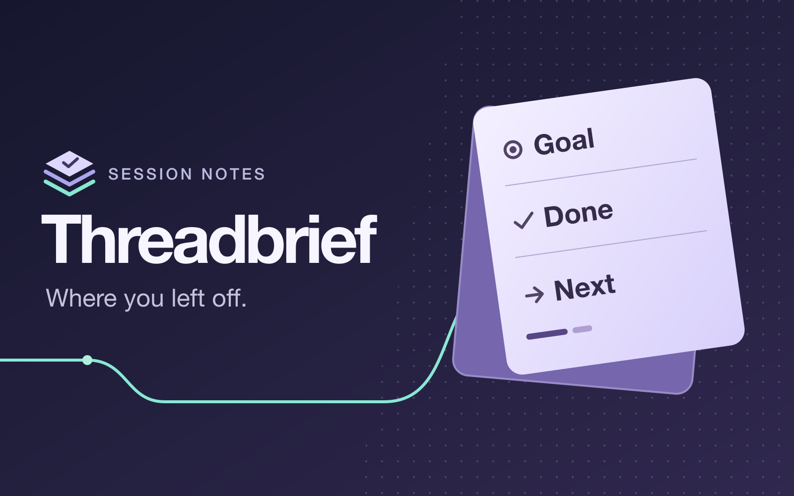

# Threadbrief for Orca

Pick up where you left off. Select an agent tab in Orca and open **Threadbrief** in the right sidebar. By default, the panel shows the last substantive reply from that session once the agent finishes. No workflow profile, API key or report file is required.

**[Start here: get your first summary](docs/getting-started.md)**. Try a short task, see exactly what appears, and learn how to ask for a three-line handoff in your own language.



**Paired Orca servers:** install Threadbrief on the desktop that shows the panel. It reads the selected session from its own paired server and starts a recap there only after a preview. No plugin installation on the server is required. Report files, exclusions and workflow profiles do not sync between machines. [Paired setup and limitations](docs/getting-started.md#using-a-paired-orca-server).

## Install

Requires Orca **1.4.268** or newer. Enable plugins under **Settings → Plugins**. Once the repository is published, install from GitHub:

```sh
orca plugin install naqswell/orca-threadbrief --json
```

Orca asks for approval before running code. Review the publisher, repository and permissions, then run the approval command printed by your own installation. Open the panel from the sidebar or with:

```sh
orca plugin open naqswell.session-summary --panel summary
```

If you have the plugin source locally, run `orca plugin install . --json` from its directory instead. On Linux outside an Orca-managed terminal, use `orca-ide` in place of `orca` for the CLI examples.

A folder installation uses `local.session-summary` instead. **If you already use that local plugin, do not install another folder under the same ID.** Install the GitHub version alongside it, check your existing reports, then disable the old plugin if you no longer need it. Do not delete your saved reports. The public release starts at `0.1.0`; it is not an in-place update to the older local series.

## Settings

Click the gear beside the task title. **Instant** shows existing text without a model call. For a new summary, choose **Brief recap** or **Detailed handoff**, select an installed Orca agent, and preview the exact excerpt before starting its separate session. The agent uses its existing account and model configuration. [Compare strategies and costs](docs/getting-started.md#choose-a-strategy-and-an-agent).

**Excluded summaries** skips history and saved reports for a session, workspace or project. Remove any rule there to resume. For saved reports only, turn off **Use the agent’s last reply**.

Use **Orca Settings → Plugins → Threadbrief** or the panel gear for the same preferences: local/paired history, recap strategy, preferred agent, icon, auto-open, workflow commands and their order. In native Settings the preferred agent is its installed ID (empty uses the host default); the panel offers a live picker. Context-specific operations—excluding the selected item, editing profiles and previewing an actual recap—belong to the panel, not the native preference form.

## Private workflows

**Configuring this for someone else?** [Create, check and apply a profile from the CLI](docs/workflow-profiles.md). The installed worker accepts the same JSON as the panel; no developer mode or GUI automation needed.

Expand **Settings → Workflow profiles** only if you want project-specific commands. Create a profile or choose **Import JSON** with a local file. The [example profile](examples/team-profile.json) uses neutral project data. A profile matches the beginning of an Orca project ID, not the visible workspace title. Preview the matches before saving. Imports start disabled; enable the profile and turn on **Show profile commands** when ready. If two enabled profiles match, the panel does not choose one.

A profile describes commands as an executable and its arguments, not a shell script. Choose the shell where you will paste the command. **Show first** only changes the order of two buttons on a matching command. **Copy command** copies text; **Open terminal** opens an empty shell. Neither runs the command. Use Orca’s Source Control for ordinary Git operations. An existing review link replaces the creation steps.

You can allow a profile to open a review with a specific local executable instead of the browser. Inspect the executable, fixed arguments and review host. This grant is separate from importing or enabling the profile. Use only an executable you trust. Keep real profiles out of this repository. Never put credentials into a profile, summary or link.

## Save a session report

Use a [saved report](docs/getting-started.md#save-a-report-that-wont-change-with-the-next-reply) when the handoff should stay put as the conversation continues, or when you're using a paired environment. The guide includes a complete JSON example and writer commands for bash, zsh and PowerShell. Saved session reports take priority over history; a shared worktree report is the last fallback. The panel still reads older reports without rewriting them.

## Access and data

This is a **trusted worker**, not a sandboxed theme. It reads local saved reports and Orca’s selected-tab information. The history fallback uses the Orca CLI on this machine; it does not send the conversation to a model or a remote summarization service.

| Orca permission | Why it is requested |
| --- | --- |
| `workspace:read`, `agent:read` | Identify the worktree and agent session, and react when selection or agent state changes. |
| `agent:launch` | Start a separate recap agent after you approve its prompt. Opening the panel never launches one. |
| `settings:own`, `storage:own` | Keep preferences, exclusions, workflow profiles and opener approvals on this installation. |
| `workspace:write` | Focus the new recap agent or the empty terminal opened for a workflow action. |
| `terminal:send` | Orca requires this capability to create an empty terminal. The plugin does not send text or Enter. |

## Development and release checks

No package installation or build step is needed. With Node.js 24 and the Orca CLI:

```sh
node --test
orca plugin validate . --json
```

The [release checklist](docs/v0.1.0.md#release-gates) requires a clean Orca installation on macOS, Linux and Windows plus a separate migration check. Passing Node tests or manifest validation is not a substitute for those desktop checks.

The panel tokenizes Markdown offline with [Marked 18.2.1](https://github.com/markedjs/marked/tree/v18.2.1). The browser module and its [license](vendor/marked.LICENSE) ship in `vendor/`; no CDN is used.

[MIT license](LICENSE)
